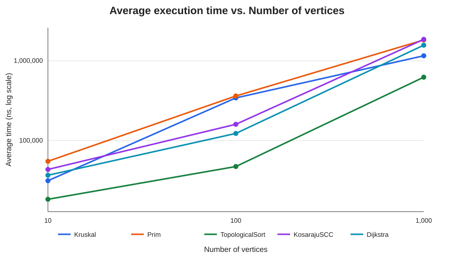
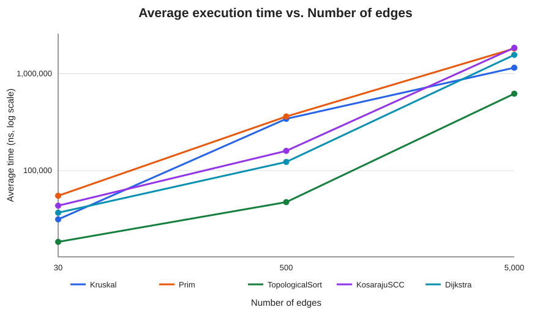

# Smart city graph algorithms

This project models city districts as vertices and roads as weighted edges. The graph uses an adjacency list, so each vertex stores the roads that leave it. The code includes minimum spanning tree algorithms, graph connectivity tools, and shortest path search.

Repository: [DAA_Assignment3](https://github.com/iuve1n/DAA_Assignment3)

## Implementation

`Graph` stores whether its edges are directed and keeps both an adjacency list and a list of added edges. `Edge` stores the start, end, and integer weight. The MST methods use an undirected graph. The connectivity methods use a directed graph.

Kruskal sorts the roads by weight and uses a disjoint set to avoid adding a road that would create a cycle. The disjoint set uses path compression and union by rank. Prim grows a tree from vertex 0 and chooses the lowest weight road from a priority queue. Both methods report the total weight and whether the graph is connected.

Topological sorting uses Kahn's algorithm. It returns an order and a flag that says whether the directed graph is acyclic. Kosaraju's algorithm finds strongly connected components with two depth first searches. Dijkstra uses a priority queue to find distances and paths from one source. It rejects negative weights because its choices rely on distances not becoming smaller after a vertex is processed.

## Complexity analysis

Let `V` be the number of vertices and `E` the number of edges. The graph uses adjacency lists. Priority queues are binary heaps.

| Algorithm | Time | Extra space |
|---|---:|---:|
| DSU `find` | Amortized `O(α(V))` across operations; at most `O(log V)` for one find with union by rank | `O(V)` for the DSU structure |
| DSU `union` | Amortized `O(α(V))` across operations; at most `O(log V)` for one union | `O(V)` for the DSU structure |
| Kruskal | `O(E log E)` for sorting, plus DSU work | `O(V + E)` |
| Prim in this implementation | `O(E log E)` worst case with duplicate queue entries | `O(V + E)` |
| Topological sort | `O(V + E)` | `O(V)` |
| Kosaraju SCC | `O(V + E)` | `O(V + E)` for the reversed graph and search state |
| Dijkstra in this implementation | `O((V + E) log E)` worst case with duplicate queue entries | `O(V + E)` |

`α(V)` grows very slowly. Path compression shortens paths used by later finds, and union by rank attaches a shorter tree below a taller one. Together they keep DSU work small in practice. Kruskal's sort is its main cost. Prim and Dijkstra can add a vertex to the queue more than once when a better edge or distance is found, which is why the bounds above use `E` for the queue size. A heap with a decrease-key operation can give the more common `O((V + E) log V)` bound.

## Experimental setup

The experiments use graphs with `(V, E)` sizes `(10, 30)`, `(100, 500)`, and `(1000, 5000)`. The fixed random seed is `20261021`. Each algorithm has one warm-up run followed by five timed runs. The recorded time is the average of the five calls to `System.nanoTime()`.

The undirected MST graphs are connected: the generator first adds a random spanning tree, then adds distinct random edges until it reaches the requested edge count. Their weights are between 1 and 100. For directed experiments, the generator adds distinct random non-self edges with the same weight range. Those graphs can contain cycles. The measured directed graphs did contain cycles, so topological sorting returned a partial order and marked them as cyclic. The correctness tests also use a DAG to check a complete valid topological order.

Kruskal reports examined edges and DSU find calls. Prim reports neighbor edge examinations and priority queue removals. Topological sort reports edge checks and the number of vertices in its returned order. Kosaraju reports edge checks and component count. Dijkstra reports examined reachable edges and priority queue removals. The operation counters come from the last of the five identical runs.

To compile and reproduce the checks and benchmark from the project root:

```sh
mkdir -p out
javac -d out $(find src tests -name '*.java')
java -cp out MSTTests
java -cp out ConnectivityTests
java -cp out DijkstraTests
java -cp out benchmark.Benchmark results.csv
```

The benchmark writes the CSV to `results.csv`. A copy of the recorded experiment is in [`results/tables/benchmark.csv`](results/tables/benchmark.csv).

## Results

Average execution time is shown in nanoseconds. Operation counts are listed as `operation_1 / operation_2` in the CSV. The meaning of each count is described above.

| Graph | Algorithm | Average time (ns) | Operation 1 / 2 |
|---|---|---:|---:|
| Undirected 10 / 30 | Kruskal | 31,349 | 11 / 22 |
| Undirected 10 / 30 | Prim | 54,999 | 60 / 11 |
| Directed 10 / 30 | Topological sort | 18,375 | 30 / 0 |
| Directed 10 / 30 | Kosaraju SCC | 43,424 | 90 / 1 |
| Directed 10 / 30 | Dijkstra | 36,741 | 30 / 13 |
| Undirected 100 / 500 | Kruskal | 342,391 | 217 / 434 |
| Undirected 100 / 500 | Prim | 362,116 | 1,000 / 216 |
| Directed 100 / 500 | Topological sort | 47,283 | 500 / 0 |
| Directed 100 / 500 | Kosaraju SCC | 159,783 | 1,500 / 1 |
| Directed 100 / 500 | Dijkstra | 122,908 | 500 / 149 |
| Undirected 1,000 / 5,000 | Kruskal | 1,155,608 | 3,534 / 7,068 |
| Undirected 1,000 / 5,000 | Prim | 1,822,966 | 10,000 / 3,541 |
| Directed 1,000 / 5,000 | Topological sort | 622,983 | 5,022 / 5 |
| Directed 1,000 / 5,000 | Kosaraju SCC | 1,855,183 | 15,000 / 15 |
| Directed 1,000 / 5,000 | Dijkstra | 1,567,591 | 4,978 / 1,432 |





Both plots use a logarithmic time axis because the algorithm times differ by a wide range. MST algorithms run on undirected graphs; the other algorithms run on directed graphs, so their times are not direct comparisons of the same input.

## Comparison and discussion

The measured time increased as the graphs grew. For the MST graphs, Kruskal was faster than Prim in these runs. Kruskal examined fewer edges than Prim, while Prim's queue processed about one item for each edge it considered. These results are specific to this graph generator and Java run; another graph shape or computer can change the timings.

The topological sort and Kosaraju operation counts grew with the number of edges, as expected for algorithms that scan adjacency lists. The directed random graphs had cycles, so topological sorting could not return a full ordering. Kosaraju found a small number of large components in those same graphs. In a DAG, each vertex is its own SCC unless there are no reverse paths between distinct vertices, which is the usual case for a DAG.

Dijkstra checked only edges reachable from vertex 0. It became slower as more vertices and edges were reachable. Its edge checks were below the total edge count in some cases because some directed edges start at unreachable vertices.

Timings include normal JVM and machine variation, and the smallest graph takes so little time that fixed overhead matters. The operation counts help explain the work done, while the complexity analysis describes how the algorithms scale as input grows.

## Testing

The test programs cover connected and disconnected MST graphs, equal weight edges, a graph with multiple minimum spanning trees, and a single vertex. They check that Kruskal and Prim return the same MST weight on connected graphs and identify disconnected graphs.

Connectivity tests check a valid topological order for a DAG, cycle detection, and SCC membership. They also check that each vertex appears in exactly one reported component. Dijkstra tests check known distances and paths, an unreachable vertex, a single vertex, negative weight rejection, and an invalid source.

## Conclusion

Kruskal and Prim both find a minimum spanning tree for a connected, undirected weighted graph. The DSU makes Kruskal's cycle checks efficient, while Prim's priority queue selects the next low-cost connection. Topological sorting is useful when a directed graph has no cycles. Kosaraju groups vertices that can reach one another. Dijkstra works for shortest routes when all edge weights are non-negative; a negative edge can make a previously finalized distance incorrect.
